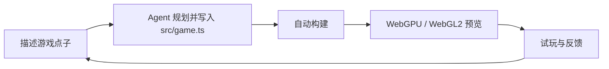
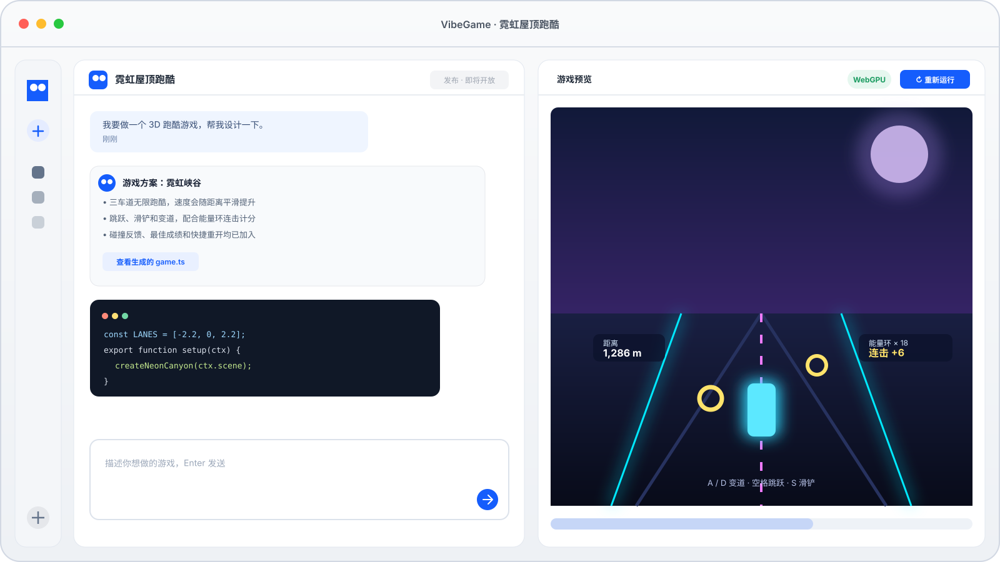
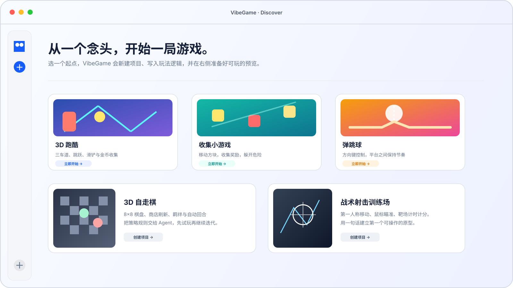

<p align="center">
  
</p>

<h1 align="center">VibeGame</h1>

<p align="center">
  用自然语言，把一个游戏想法变成可以立即试玩的 Three.js 原型。
</p>

<p align="center">
  <a href="#快速开始">快速开始</a> · <a href="#它能做什么">特点</a> · <a href="#界面预览">界面预览</a> · <a href="#引用">引用</a>
</p>

---

## 一句话

VibeGame 是一个面向桌面的对话式游戏工作台：描述玩法，Agent 会在受控的项目模板中修改 `src/game.ts`，构建并在同一窗口里运行你的 Three.js 游戏。它让“再快一点”“把障碍物变成三条道”“给失败加一点反馈”变成连续的创作对话，而不是重新开始的一轮开发。

## 它能做什么

| 能力           | 说明                                                                               |
| -------------- | ---------------------------------------------------------------------------------- |
| 对话式制作     | 从一句玩法描述开始；内置 Fibona Agent 专注于游戏逻辑文件，避免改动模板基础设施。   |
| 即时试玩       | 每次写入后自动构建；在右侧预览区重新运行，不离开当前工作台。                       |
| GPU 优先       | 使用 `THREE.WebGPURenderer`；WebGPU 不可用时自动降级到 WebGL2。                    |
| 本地项目       | 每个游戏都有自己的目录、聊天记录和构建产物；可查看项目文件并在需要时回滚快照。     |
| 可选本机 Agent | 可通过 ACP 接入本机的 Claude Code 或 Codex，复用已有的本机登录状态。               |
| 多语言界面     | 界面内置中文、英语、日语、法语、德语、西班牙语、葡萄牙语、俄语、印地语和阿拉伯语。 |

## 创作路径



VibeGame 把这一循环留在一个窗口里：左边保留思考与修改记录，右边是可运行的游戏；每个项目的源文件仍然是你能随时打开、检查和继续编辑的普通文件。

## 界面预览

<p align="center">
  
</p>

<p align="center"><sub>工作区示意：从玩法讨论、生成 <code>game.ts</code>，到右侧实时试玩。</sub></p>

<p align="center">
  
</p>

<p align="center"><sub>灵感起点：选一个类型，或从自己的游戏念头开始。</sub></p>

## 快速开始

本仓库使用 Hutch 管理开发与桌面构建流程：

```bash
git clone https://github.com/section9-lab/VibeGame.git
cd VibeGame
hutch install
hutch start
```

开发时使用：

```bash
hutch dev
```

构建桌面应用：

```bash
hutch build
```

发布流程见 [.github/RELEASING.md](.github/RELEASING.md)：推送 `v*` tag 即可在 GitHub Actions 构建并发布 macOS arm64 DMG。

启动后，选择一个灵感卡片或直接输入描述。首次试玩请在右侧点击“运行”；若游戏没有响应键盘，先点一下预览区域以让它获得焦点。

## 项目结构

```text
src/
  main/                 # 桌面宿主、项目与 Agent 编排
  mainview/             # React + shadcn/ui 工作台
resources/
  engine/               # 运行时与 Agent 桥接
  template/             # 每个游戏项目的 Three.js 模板
  branding/             # 应用图标与品牌标记
benchmarks/             # WebGPU 与 WebGL2 的渲染基准
```

游戏模板刻意把可生成的玩法逻辑集中到 `resources/template/src/game.ts`：它导出 `setup(ctx)` 与 `update(dt, input)`，让 Agent 的写入边界和游戏代码边界都保持清晰。

## 运行模型与隐私

- 内置 Agent 的模型凭据按本机设置使用；界面将登录信息保存在本地。
- 通过 ACP 使用本机 Claude Code 或 Codex 时，VibeGame 调用你已经在本机登录的工具；对应订阅授权不由 VibeGame 托管。
- 游戏项目、对话历史和预览构建产物按项目保存在本机目录中。

请在启用能执行本地命令的 Agent 前，先确认它具有你期望的访问范围。

## 引用

如果 VibeGame 帮助了你的研究、课程或原型工作，欢迎引用它。仓库根目录提供机器可读的 [CITATION.cff](./CITATION.cff)。

```bibtex
@software{vibegame_2026,
  author  = {VibeGame Contributors},
  title   = {VibeGame: a conversational desktop workspace for building playable Three.js games},
  year    = {2026},
  version = {0.1.0},
  url     = {https://github.com/section9-lab/VibeGame}
}
```

## 状态与贡献

VibeGame 仍在积极开发中。欢迎通过 Issue 或 Pull Request 分享新玩法模板、渲染优化、Agent 工作流与可复现的性能基准。

> 许可信息尚未在此仓库中声明；在复制、分发或用于生产前，请先与维护者确认适用的授权条款。
